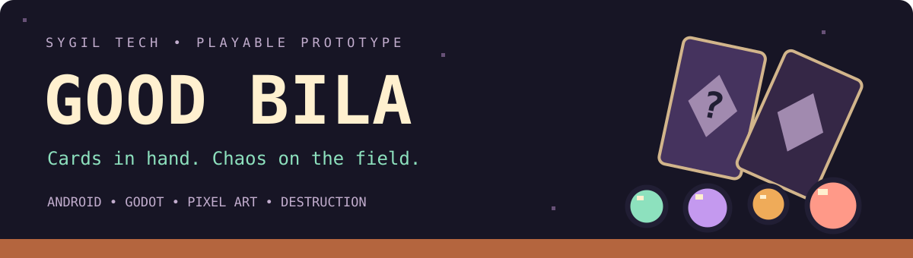

# Sygil Tech

## Featured · Good Bila

A pixel-art mobile prototype: aim, burst marbles, and use cards to change every shot. **Destruction · 13 cards · 11 effects · Android / Godot · English.**

[**Meet the game and see screenshots →**](docs/good-bila/README.md) · [**Play the Android prototype →**](https://github.com/levymtmr/Sygil-Tech/releases/tag/good-bila-v0.23.0) · [**♥ Support / discuss investment →**](docs/good-bila/SUPPORT.md)

[How to play](docs/good-bila/README.md#how-to-play) · [Development status](docs/good-bila/DEVELOPMENT.md) · [Game source](projetos/bila-mobile/)

---

Sygil Tech's company website and project portfolio. Lendas de Astera is a browser-based tactical RPG built with TypeScript, Vite, Canvas, and pixel-art sprite sheets.

## Play

[Sygil Tech website](https://levymtmr.github.io/Sygil-Tech/) · [Play Lendas de Astera](https://levymtmr.github.io/Sygil-Tech/projetos/astera/)

1. Install a recent Node.js release.
2. Install project dependencies with `npm install`.
3. Start the development server with `npm run dev` and open the local URL printed in the terminal.
4. Run `npm run build` to check the production build.

## Lendas de Astera controls

- **Exploration:** arrow keys or WASD, on-screen direction buttons, or tap/click a neighboring tile.
- **Encounters:** approach a creature and choose its encounter action.
- **Combat:** the action menu floats above Kael during his turn. Choosing an action collapses the menu; tap the character tile to reopen it. Click/tap tiles to move or choose targets in range. Each class has its own attack animations.
- **Map:** click the minimap or press **M** to open the world map. Press **M** again to close it. Explored areas reveal gradually; unexplored areas remain covered by fog.
- **HUD:** **I** opens inventory, **Q** opens equipment and character details, **L** opens the event log, and **Escape** closes the current panel. Panels are also available from the compact dock.
- **Starting and classes:** choose Knight, Archer, or Mage before starting. The class selector stays available before the first victory. Classes have distinct attributes, abilities, equipment, and appearance.
- **Skill tree:** level up to gain points and unlock skills in the equipment/character panel (**Q**). Choose a skill during combat, then a target tile; healing and defensive skills target your own character.
- **Equipment and inventory:** drag items around the inventory grid or tap two slots to swap them. Equip or remove weapons, armor, and accessories. Attribute bonuses affect combat; potions can be used from inventory.
- **Bestiary:** open it from the top button. Creatures you encounter reveal attributes and loot chances.
- **Rewards:** victory shows experience, coins, new levels, and loot. Items enter the inventory.
- **Mobile:** on-screen controls and large buttons; landscape orientation gives the board more space.

## RPG prototype features

Grid-based exploration with regions, creatures, and nearby encounters; smooth movement, stepping animations, slashes, arcane projectiles, and floating damage; enemies that move and attack; an on-demand interface; bestiary, rewards, experience, levels, potions, and increasing difficulty. There is no quest journal. Prototype progress lives in memory: reloading the page begins a new journey.

## Code organization

`src/main.ts` loads styles and starts the application. Responsibilities are divided into:

- `src/app/`: startup and input events for movement, panels, inventory, base, and shop.
- `src/features/`: gameplay features organized into `combat`, `world`, `character`, `inventory`, `base`, and `store`.
- `src/rendering/`: board, characters, effects, and canvas animation rendering.
- `src/ui/`: HTML structure, element access, and panel updates.
- `src/data/`: classes, items, monsters, regions, and furniture catalogs. `catalogs.ts` maintains compatibility exports.
- `src/game/`: typed shared state and rules independent of the interface.
- `src/types.ts` and `src/types/`: game contracts and types.
- `src/styles/`: styles organized by screen and component; `style.css` and `ux.css` define cascade order.

Put new functionality in the relevant `features/` module, data in `data/`, and events in `app/`. Keep drawing in `rendering/` and rules in `game/`.

Validation: `npm run build` checks types and creates the production bundle. Use `npm run dev` for manual checks of menus, class selection, exploration, combat, inventory, base, shop, and workshop.

Good Bila is a separate native Godot project in `projetos/bila-mobile/`; see its own README for execution and Android export.

## GitHub Pages deployment

`.github/workflows/deploy-pages.yml` runs on pushes and pull requests. It installs dependencies with `npm ci`, runs `npm test`, checks types/build with `npm run build`, and validates pages. Pushes to `main` automatically deploy `dist/` to GitHub Pages; other branches and pull requests run validation only. Deployment can also be started from **Actions**.

Repository setup: choose **Settings → Pages → Source → GitHub Actions**. The final URL appears in the `github-pages` environment after deployment.

Vite uses relative paths so resources work under the repository URL. Only the static build is deployed; no local server needs to remain running. Browser-game progress stays in memory and resets when the page reloads.

Good Bila's Android APK is published separately through the **Good Bila · Android prototype** workflow and repository Releases.

## Shop and workshop

Interiors use the same pixel-art sprite sheets as the map: counters, shelves, workbenches, plants, mats, and lights. Atlas regions are shared between Canvas and the interface through `src/data/spriteAtlas.ts`. Touch, mouse, and drag interactions are supported.

## Company website and projects

The root `index.html` presents Sygil Tech, its services, and projects. Company code lives in `src/company/`, with copy and contact configuration in `src/company/content.ts`. The RPG keeps its own entry at `src/main.ts`, available through `projetos/astera/index.html`. Vite builds both pages without loading RPG resources on the company page.

## Memória do Saber

An educational memory game in `projetos/memoria/` for mobile and desktop. Animal, fruit, and number themes; 4, 6, or 8 pairs; facts for each match; unlimited attempts and no time limit. Supports touch, mouse, and keyboard (Tab and Enter/space). Progress lasts only while the page remains open.

The Pages workflow publishes it at https://levymtmr.github.io/Sygil-Tech/projetos/memoria/.

## Retro Blocks

A 16-bit-style block game in `projetos/retro-blocks/`. Complete lines to score; speed increases every ten lines. Arrow keys move and rotate, space drops, P pauses, and Enter starts or pauses. Mobile includes on-screen buttons. Features a next-piece preview, optional sound, and a browser-local best score. Leaving the window pauses play; reloading resets the run. Published through the same Pages workflow.

## Sygil Play

Visit `/play/` to choose Lendas de Astera, Memória do Saber, Retro Blocks, Dots, the picture puzzle, or Arena dos Quatro. The company footer provides a Play link, and all browser games link back to the selection.

**Dots:** connect neighboring dots of the same color by dragging or tapping, then confirm. Loops of four or more dots remove every dot of that color. Backtrack one step to undo. Includes 30-move rounds or free play, local best score, and symbols that distinguish colors.

**Picture puzzle:** swap two tiles by tapping/clicking to assemble one of three original illustrations. Difficulty choices are 9, 16, or 25 tiles, with a full-image preview and optional numbers. Tab and Enter/space also select tiles and controls. Reloading begins a new game.

## Arena dos Quatro

A local prototype for four players sharing one device, available at `/projetos/arena/` and through Sygil Play. Start locally with `npm run dev`. Each player controls a fixed class: Warrior, Archer, Mage, or Rogue.

Each turn allows 20 seconds, one move of up to three tiles, and one action, in either order. Abilities have a cooldown of two personal turns. Defeating an opponent scores one point; being the sole occupant of the four central tiles at the end of a round also scores one point. The first player to five points wins. Defeated heroes respawn at full health on their next turn. The game can be paused/restarted; reloading clears the session.

Rules live in `src/arena/engine.ts`, the interface in `src/arena/main.ts`, and tests in `tests/arena.test.mjs`. This version has no network connection or computer-controlled opponents. A 10–15 minute match length is a target to validate through playtesting.
