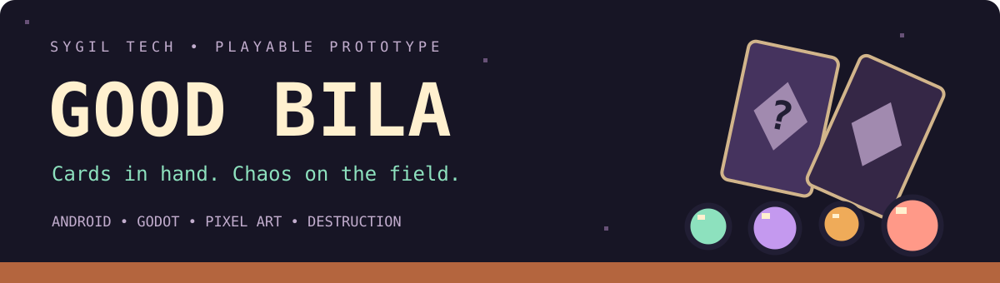
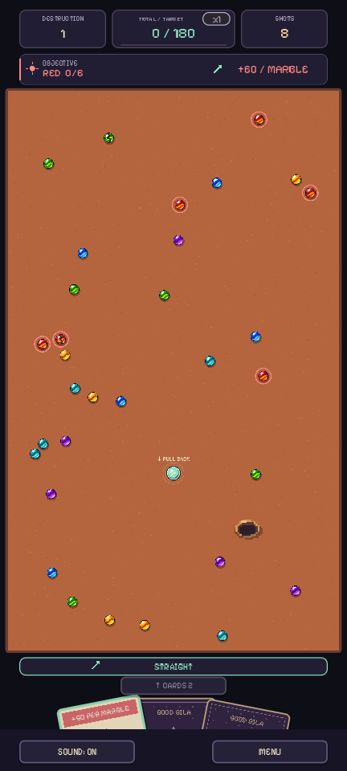
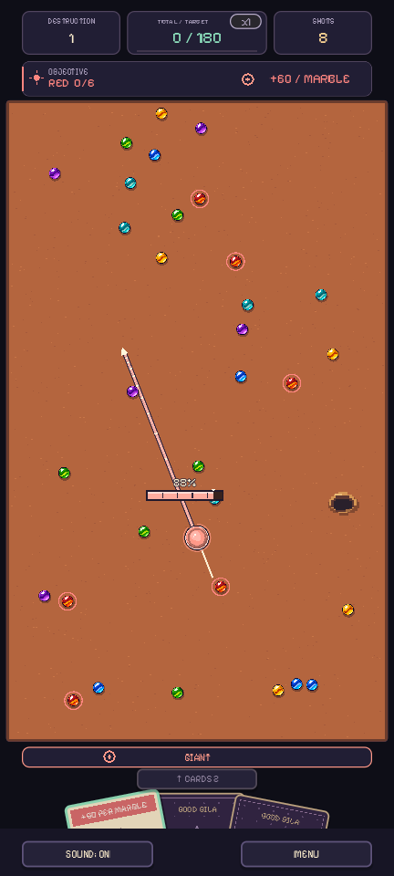
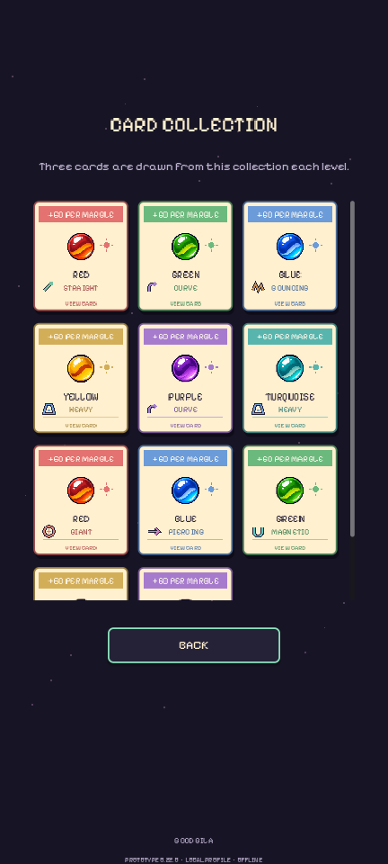
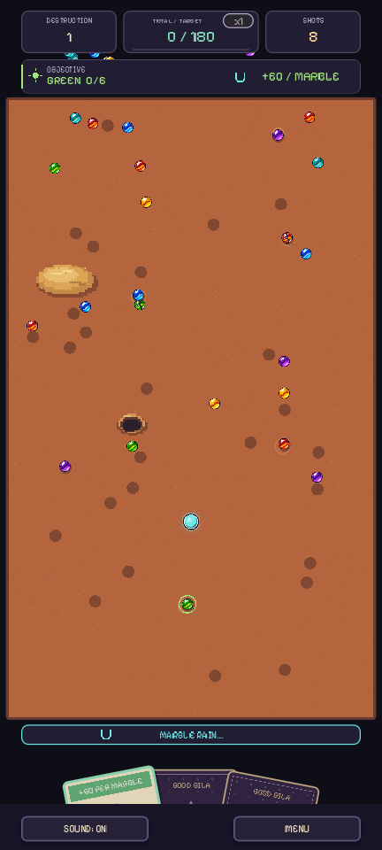

# Good Bila

**A backyard marble game reimagined through physics, cards, and tough decisions.**

In Good Bila, aiming is only part of the challenge. Every card changes both your objective and the way your marble behaves. Hit, crack, and burst your targets, adapt to the hand you draw, and reach the next score target before your shots run out.

[**Play the prototype**](#play-the-prototype) · [**How to play**](#how-to-play) · [**Cards and effects**](#cards-that-change-the-game) · [**Support / invest**](SUPPORT.md) · [**Development**](DEVELOPMENT.md)

> **Status:** playable prototype **0.22.0**, in active development. Portrait Android gameplay and desktop execution through Godot. The screenshots below show the actual English-language prototype; field layouts change each level.

<table><tr><td align="center"> <strong>A field of possibilities</strong></td><td align="center"> <strong>One card changes the shot</strong></td><td align="center"> <strong>One more run?</strong></td></tr></table>

## Why play?

- **Physics with purpose.** Direction, power, positioning, and collisions create opportunities for chain reactions.
- **Luck that rewards strategy.** Your three face-down cards come from the entire collection. Decide when to keep your current effect and when to risk another draw.
- **Effects you can see.** Your marble changes size, color, and animation alongside its behavior: giant, magnetic, explosive, and more.
- **Rising targets.** Destruction carries your score across levels. Completing objectives in sequence increases the multiplier for your next points.
- **Backyard character.** Marbles, sand, pits, pixel art, and original music give the prototype its identity.

The inspiration comes from traditional backyard marble games and the joy of finding a better combination on each attempt. The current prototype has its own identity and rules; it does not reproduce traditional triangle-marble rules.

## Play the prototype

### Android

[**Download Good Bila 0.22.0 for Android**](https://github.com/levymtmr/Sygil-Tech/releases/download/good-bila-v0.22.0/good-bila-0.22.0.apk) · [Release page and installation notes](https://github.com/levymtmr/Sygil-Tech/releases/tag/good-bila-v0.22.0)

1. Download the APK and open it on your Android device.
2. Allow installation from that source when Android asks.
3. Create a local nickname, tap **Start**, and draw your first card.

This is a test distribution outside Google Play. The public APK uses a development signing key: if Android rejects an update over an earlier prototype with a different signature, uninstall the earlier version first. Your profile and best score are stored locally.

### Desktop / Godot

Clone this repository, open [`projetos/bila-mobile/project.godot`](../../projetos/bila-mobile/project.godot) in **Godot 4.4.1**, and press **F5**. Drag with your mouse as you would with your finger. This is not a browser build.

[Technical setup and APK export](../../projetos/bila-mobile/README.md)

## How to play

1. **Receive three face-down cards.** Any of the 11 collection cards can appear. There is no deck building.
2. **Pull a card upward** and confirm. It reveals a target color and an effect for your marble.
3. **Wait for the marble rain.** Targets fall onto the field, scatter, and create a different layout each level.
4. **Press your marble, pull back, and release.** The gauge shows shot power; at maximum power, it turns red and shakes.
5. **Hit twice to burst a target.** The first impact cracks a marble; the second destroys it and awards points. Marble-to-marble collisions can also cause damage.
6. **Prioritize your objective.** The requested color is worth **60 base points**; other colors are worth **5**, before the multiplier.
7. **Decide whether another card is worth spending.** Your current objective and effect remain active until replaced. You may reveal only one card per shot.
8. **Reach the target.** Scores accumulate: 180, 480, 900, 1440… The next level brings a new hand and field. If shots or targets run out before the required score, the run ends.

The first level has **32 marbles and eight shots**. Target counts rise to 56, and the shot allowance rises to 12. Sand slows your marble; pits trap it until the next shot. Each level draws one to three obstacles, with three-obstacle layouts appearing rarely.

## Cards that change the game

The collection has **11 cards and nine effects**. Some cards share an effect but request different colors.

| Effect | What changes |
|---|---|
| Straight | Follows your aiming direction. |
| Curve | Bends to the right during the shot. |
| Bouncing | Makes three hops; while airborne, passes over marbles and obstacles. |
| Heavy | More mass and impact, with shorter range. |
| Giant | Increases the marble's size, collision area, and mass. |
| Piercing | Passes through multiple targets and deals one hit to each per shot. |
| Magnetic | Pulls nearby marbles while moving. |
| Explosive | The first impact damages and pushes nearby targets. |
| Ricochet | Makes better use of walls through stronger rebounds and lower drag. |

Icons help identify the current state, and the marble itself changes color and animation. The collection lets you learn the possibilities; browsing it does not change your randomly drawn hand.

<table><tr><td align="center"> <strong>Explore every card</strong></td><td align="center"> <strong>A new layout every level</strong></td></tr></table>

## Where the project stands

**Playable now:** a complete run loop, random cards, nine physics effects, obstacles, multipliers, collection browser, game over summary, local profile and best score, original music, and touch/mouse controls.

**Next priorities:** balance difficulty and effect combinations; test on more Android devices; improve readability, accessibility, and presentation; explore additional content based on player feedback.

The prototype still needs broader validation of difficulty, retention, and device performance. There are no published audience, revenue, or funding figures. The current focus is a consistent, enjoyable core experience.

[Technical status, limitations, and priorities](DEVELOPMENT.md) · [Recent changes](../../projetos/bila-mobile/CHANGELOG.md)

## Help shape the next step

You can help by playing, sharing feedback, spreading the word, contributing art, audio or development work, or discussing production, publishing, and investment.

### [♥ Support Good Bila's development](SUPPORT.md)

**Interested in a partnership or investment?** [Send a proposal on GitHub](https://github.com/levymtmr/Sygil-Tech/issues/new?template=good-bila-support.yml), or contact **Levy Mota Moreira** directly: [email](mailto:levymmoreira@icloud.com?subject=Good%20Bila%20-%20Partnership%20and%20support) · [GitHub profile](https://github.com/levymtmr).
