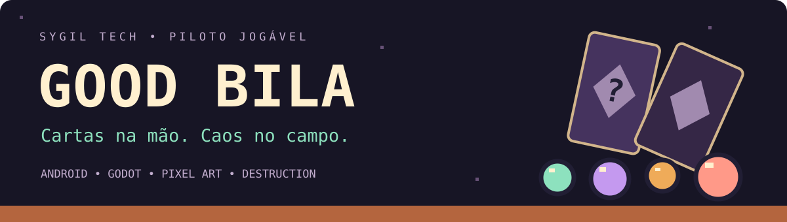
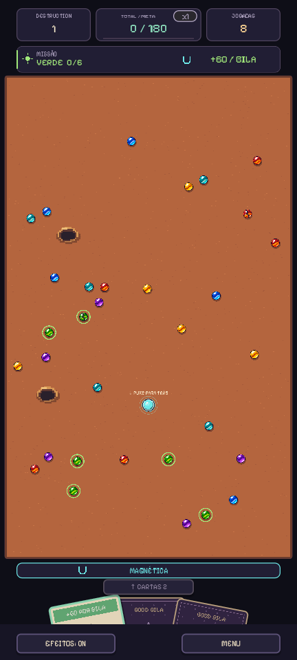
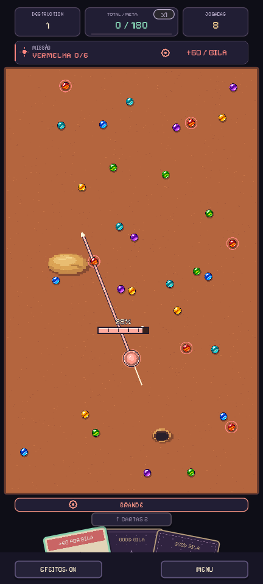
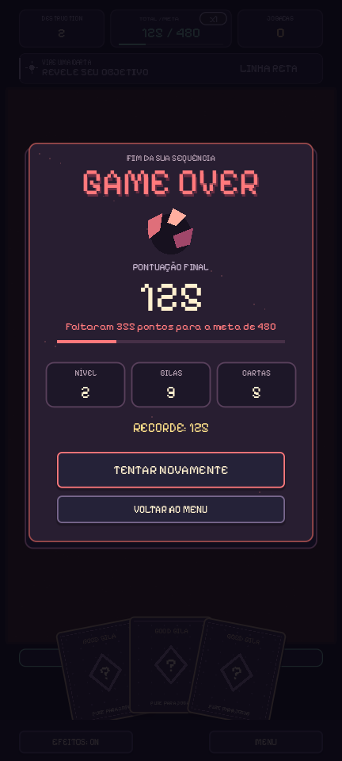
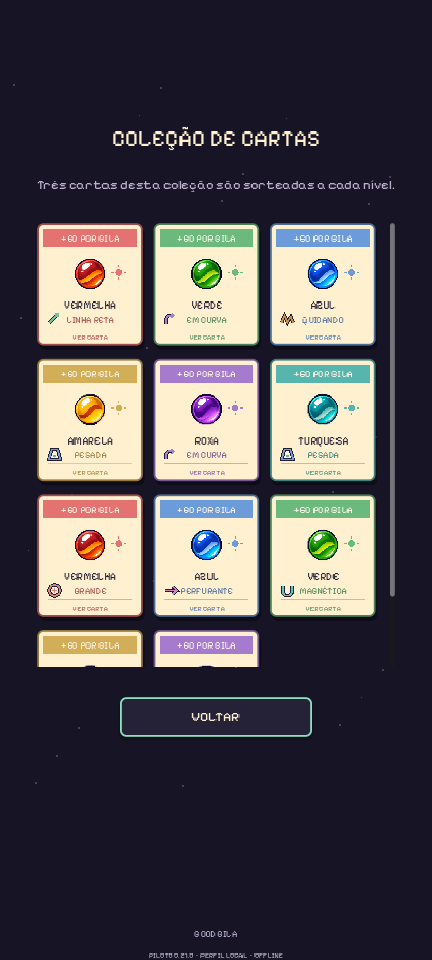
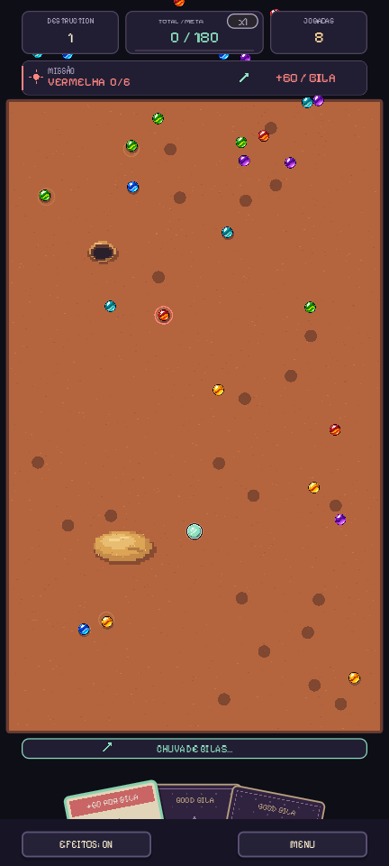

# Good Bila

**Uma brincadeira de quintal transformada em um jogo de física, cartas e decisões difíceis.**

Em Good Bila, você não controla apenas a mira: cada carta muda o objetivo e o comportamento da sua bila. Acerte, rache e estoure os alvos, improvise com a mão que recebeu e alcance a próxima meta antes de acabar suas jogadas.

[**Jogar o piloto**](#jogue-o-piloto) · [**Como jogar**](#como-jogar) · [**Coleção e efeitos**](#cartas-que-mudam-o-jogo) · [**Apoiar / investir**](APOIE.md) · [**Desenvolvimento**](DESENVOLVIMENTO.md)

> **Status:** piloto jogável **0.21.0**, em desenvolvimento ativo. Android em orientação vertical e execução no computador pelo Godot. As imagens abaixo são capturas reais do piloto; os cenários variam a cada nível.

<table>
<tr><td align="center"> <strong>Um campo de possibilidades</strong></td><td align="center"> <strong>Uma carta muda a jogada</strong></td><td align="center"> <strong>Sempre dá vontade de tentar de novo</strong></td></tr>
</table>

## Por que jogar?

- **Física com intenção.** Direção, força, posicionamento e colisões criam oportunidades de reações em cadeia.
- **Sorte que pede estratégia.** As três cartas vêm viradas para baixo, sorteadas da coleção inteira. Você decide quando conservar o efeito atual e quando arriscar outra carta.
- **Efeitos que aparecem na bila.** Tamanho, cor e animação mudam junto com o comportamento: gigante, magnética, explosiva e outras possibilidades.
- **Metas crescentes.** O modo Destruction acumula pontos entre níveis. Missões concluídas em sequência aumentam o multiplicador da próxima pontuação.
- **Identidade de quintal.** Bilas, areia, buracos, pixel art e música original formam o cenário do piloto.

A inspiração vem do jogo de bila e do prazer de buscar uma combinação melhor a cada tentativa. O piloto atual tem identidade e regras próprias; não é uma reprodução das regras tradicionais do triângulo.

## Jogue o piloto

### Android

[**Baixar o APK 0.21.0 para Android**](https://github.com/levymtmr/Sygil-Tech/releases/download/good-bila-v0.21.0/good-bila-0.21.0.apk) · [Página da versão e notas de instalação](https://github.com/levymtmr/Sygil-Tech/releases/tag/good-bila-v0.21.0)

1. Baixe o APK e abra o arquivo no Android.
2. Autorize a instalação por essa origem quando o sistema solicitar.
3. Crie um apelido local, toque em **Iniciar** e puxe sua primeira carta.

É uma distribuição de teste, fora da Play Store. O APK público usa assinatura de desenvolvimento: se o Android rejeitar a instalação sobre um piloto anterior com assinatura diferente, desinstale o anterior antes. O registro e o recorde são locais.

### Computador / Godot

Clone este repositório, abra [`projetos/bila-mobile/project.godot`](../../projetos/bila-mobile/project.godot) no **Godot 4.4.1** e pressione **F5**. Arraste com o mouse como faria com o dedo. Não é uma versão de navegador.

[Instruções técnicas e exportação de APK](../../projetos/bila-mobile/README.md)

## Como jogar

1. **Receba três cartas às cegas.** Qualquer uma das 11 cartas da coleção pode aparecer. Não há montagem de deck.
2. **Puxe uma carta para cima** e confirme. Ela revela uma cor de objetivo e um efeito para a sua bila.
3. **Espere a chuva de bilas.** Os alvos caem no campo, espalham-se e deixam uma configuração diferente a cada nível.
4. **Pressione sua bila, puxe para trás e solte.** O gauge mostra a força; no máximo, fica vermelho e treme.
5. **Acerte duas vezes para estourar.** O primeiro impacto racha o alvo; o segundo destrói e pontua. Colisões entre bilas também podem causar dano.
6. **Priorize a missão.** A cor pedida rende **60 pontos base**; as outras, **5**, antes do multiplicador. Escolha bem o que atingir.
7. **Decida se vale gastar outra carta.** O objetivo e o efeito atuais continuam nas próximas tacadas até você trocar. Só é possível revelar uma carta por tacada.
8. **Bata a meta.** Os pontos acumulam: 180, 480, 900, 1440… O próximo nível traz uma nova mão e outro campo. Se as jogadas ou os alvos acabarem antes da meta, é game over.

O primeiro nível tem **32 bilas e oito jogadas**. A quantidade de bilas cresce até 56, e as tentativas chegam a 12. Areia desacelera; buracos prendem a bila até a próxima tacada. Cada rodada sorteia de um a três obstáculos, com três aparecendo raramente.

## Cartas que mudam o jogo

A coleção tem **11 cartas e nove efeitos**. Algumas cartas compartilham um efeito, mas pedem cores diferentes.

| Efeito | O que muda na jogada |
|---|---|
| Linha reta | Segue a direção da mira. |
| Em curva | Desvia para a direita durante o lançamento. |
| Quicando | Dá três saltos; enquanto está no ar, passa sobre bilas e obstáculos. |
| Pesada | Mais massa e impacto, com menor alcance. |
| Grande | Aumenta o tamanho, a colisão e a massa da bila. |
| Perfurante | Atravessa vários alvos e causa um impacto em cada um por tacada. |
| Magnética | Atrai bilas próximas enquanto se move. |
| Explosiva | O primeiro impacto causa dano e impulso nos alvos próximos. |
| Ricochete | Aproveita as paredes com rebotes fortes e menor desaceleração. |

Os ícones ajudam a ler o estado, mas a própria bila também muda de cor e animação. A coleção é para conhecer as possibilidades; consultá-la não altera a mão sorteada.

<table><tr><td align="center"> <strong>Conheça todas as cartas</strong></td><td align="center"> <strong>Uma nova distribuição a cada nível</strong></td></tr></table>

## Onde o projeto está

**Já jogável:** ciclo completo de partida, cartas aleatórias, nove efeitos físicos, obstáculos, multiplicadores, coleção, game over, perfil e recorde locais, música e controles de toque/mouse.

**Próximas prioridades:** balancear dificuldade e combinações; ampliar testes em aparelhos Android; melhorar leitura visual, acessibilidade e apresentação; explorar mais conteúdo a partir dos testes com jogadores.

O piloto ainda precisa de validação de retenção, dificuldade e desempenho em uma amostra maior de celulares. Não há números públicos de público, receita ou investimento captado. O foco atual é tornar a experiência consistente e divertida.

[Ver estado técnico, limites e prioridades](DESENVOLVIMENTO.md) · [Histórico recente](../../projetos/bila-mobile/CHANGELOG.md)

## Faça parte do próximo passo

Você pode ajudar testando, divulgando, colaborando com arte, áudio, desenvolvimento ou conversando sobre produção, publicação e investimento.

### [♥ Apoie o desenvolvimento do Good Bila](APOIE.md)

**Interessado em parceria ou investimento?** [Apresente sua proposta no GitHub](https://github.com/levymtmr/Sygil-Tech/issues/new?template=good-bila-apoio.yml) ou fale diretamente com **Levy Mota Moreira**: [e-mail](mailto:levymmoreira@icloud.com?subject=Good%20Bila%20-%20Parceria%20e%20apoio) · [perfil no GitHub](https://github.com/levymtmr).
